# Visual Prompt Library · AI 出图模板库

把视觉参考变成可复用的图片提示词和出图流程。收录 **31 套出图模板**。按自媒体内容、个人形象、电商与品牌、插画与短剧查找。自媒体进一步细分为小红书竖封、公众号／视频封面和账号横幅。每套都有可复制的调用示例。

## 安装

本库采用 [Agent Skills 开放格式](https://agentskills.io/specification)。从 GitHub 克隆或解压后，把完整的 `skills/visual-prompt-library/` 文件夹放到所用平台的 Skill 目录里，保留 `SKILL.md`、`references/` 和 `assets/`。

| 平台 | 可用的项目目录 | 可用的个人目录 |
| --- | --- | --- |
| Codex | `.agents/skills/` | `~/.agents/skills/` |
| [Claude Code](https://code.claude.com/docs/en/skills) | `.claude/skills/` | `~/.claude/skills/` |
| [VS Code 的 GitHub Copilot](https://code.visualstudio.com/docs/agent-customization/agent-skills) | `.github/skills/` | `~/.copilot/skills/` |

安装后按平台的方式调用 `visual-prompt-library`，也可以直接说「用 visual-prompt-library 的 C9 做一张小红书竖封」。支持 Agent Skills 的其他平台可按自己的目录规则安装。直接生成和编辑图片取决于平台可用的图片工具。Codex 可用内置 GPT 图片工具，有其他图片工具的 Agent 可使用其已接入的工具。没有图片工具时，可以让 Agent 输出可复制的提示词，再到出图工具使用。

## 怎么用

1. 选模板，或让 Skill 根据内容挑选。封面可指定平台、画幅、标题文字和留白位置。
2. 如需维持真实人物、商品或版式，上传参考并说明每张图的用途。例如「图 1 锁脸，图 2 锁衣服，图 3 参考构图」。
3. 指定要成图还是提示词。要成图就说「直接出图」，只要提示词就说「给我可复制的提示词」。
4. 做同一人物或产品的多张图时，沿用同一原始参考。带字版检查字形、数字与裁切；涉及真实信息时提供准确文案。

使用示例：

> `$visual-prompt-library` 用 C7 做公众号封面，标题「我做了一整套咖啡品牌设计」，右侧工作台展板展示我上传的包装、菜单和海报。直接出图。

## 按使用场景选模板

[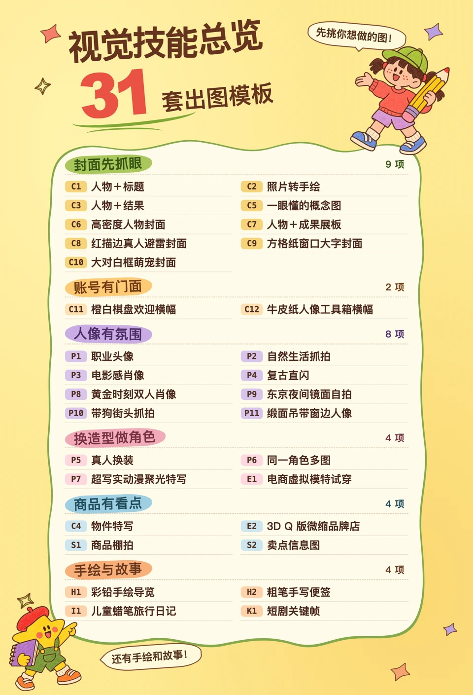](examples/overview.webp)

| 使用场景 | 具体用途 | 模板 |
| --- | --- | --- |
| [自媒体内容](#media) | [小红书竖封](#xiaohongshu) | [C8 红描边真人避雷封面](#c8) · [C9 方格纸窗口大字封面](#c9) · [C10 大对白框萌宠封面](#c10) |
| [自媒体内容](#media) | [公众号／视频封面](#article-video) | [C1 人物＋标题](#c1) · [C2 照片转手绘](#c2) · [C3 人物＋结果](#c3) · [C5 一眼懂的概念图](#c5) · [C6 高密度人物封面](#c6) · [C7 人物＋成果展板](#c7) |
| [自媒体内容](#media) | [账号横幅](#account-banner) | [C11 橙白棋盘欢迎横幅](#c11) · [C12 牛皮纸人像工具箱横幅](#c12) |
| [个人形象](#personal) | 头像、日常写真、真人换装 | [P1 职业头像](#p1) · [P2 自然生活抓拍](#p2) · [P3 电影感肖像](#p3) · [P4 复古直闪](#p4) · [P5 真人换装](#p5) · [P8 黄金时刻双人肖像](#p8) · [P9 东京夜间镜面自拍](#p9) · [P10 带狗街头抓拍](#p10) · [P11 缎面吊带窗边人像](#p11) |
| [电商与品牌](#commerce) | 商品展示、虚拟试穿、品牌图 | [C4 物件特写](#c4) · [E1 电商虚拟模特试穿](#e1) · [E2 3D Q 版微缩品牌店](#e2) · [S1 商品棚拍](#s1) · [S2 卖点信息图](#s2) |
| [插画与短剧](#creative) | 手绘海报、角色图、短剧关键帧 | [H1 彩铅手绘导览](#h1) · [H2 粗笔手写便签](#h2) · [I1 儿童蜡笔旅行日记](#i1) · [P6 同一角色多图](#p6) · [P7 超写实动漫聚光特写](#p7) · [K1 短剧关键帧](#k1) |

## 自媒体内容

### 小红书竖封

#### C8 · 红描边真人避雷封面

3:4 竖长图。红描边真人配两行白黄大字，适合避坑、误区和经验复盘。

> `$visual-prompt-library` 用 C8 做「装修避雷」封面，第二行写「这4项先问清！」，用原创短发人物和四张黄标签突出报价、加价、材料、验收。

**验图重点** · 人脸和手势完整，黄标签在小图下能读清。

[查看模板规则](skills/visual-prompt-library/references/social-covers.md)

#### C9 · 方格纸窗口大字封面

3:4 竖长图。用圆角方格活页纸、胶带和红色圈线承载纯文字。

> `$visual-prompt-library` 用 C9 做「整理桌面只要三步」竖版封面，用红笔圈出「整理桌面」，最后一行写「先从清空开始」。

**验图重点** · 首行最大，方格退到背景，圈线只标重点。

[查看模板规则](skills/visual-prompt-library/references/social-covers.md)

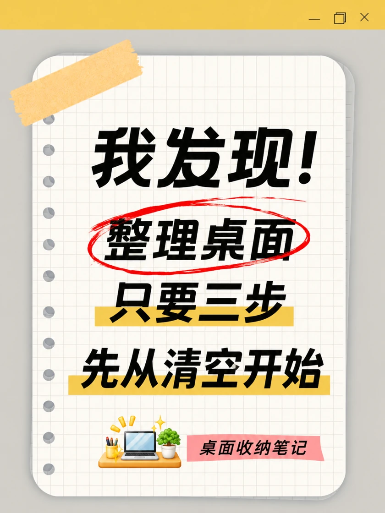

#### C10 · 大对白框萌宠封面

3:4 竖长图。大对白框讲方法和结果，下方让萌宠或吉祥物出场。

> `$visual-prompt-library` 用 C10 做「早餐提前备」竖版封面，右下角让穿格纹围裙的橘猫捧燕麦杯，左侧写「燕麦杯」「水果盒」。

**验图重点** · 对白框尖尾朝向角色，脸和主题道具清楚。

[查看模板规则](skills/visual-prompt-library/references/social-covers.md)

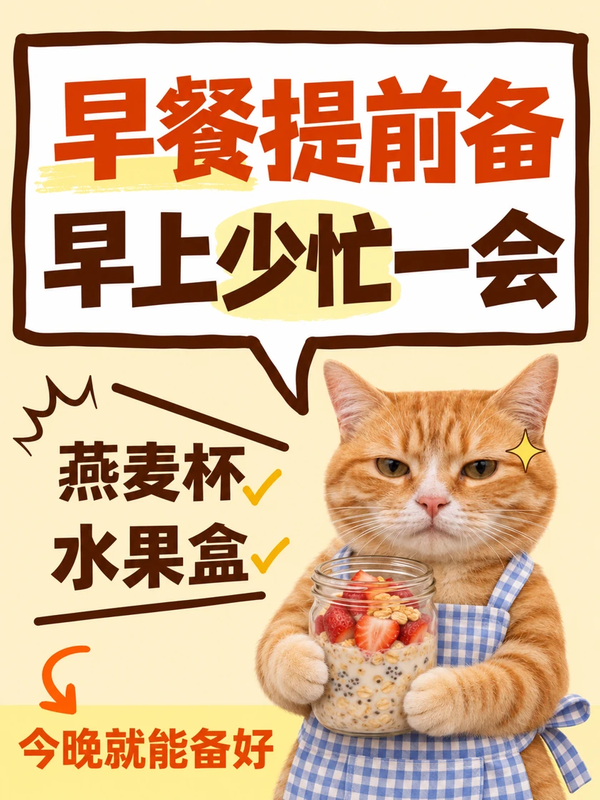

### 公众号／视频封面

#### C1 · 人物＋标题

访谈、专栏、人物观点。提供人物照片或角色描述、标题原文，以及要不要直接排字。

> `$visual-prompt-library` 用 C1 做横版公众号封面，左侧放一位窗边改稿的虚构创作者，右侧排入「我用 AI 做了一个月的内容」。

**验图重点** · 人物偏左，右侧文字与人脸分开。

#### C2 · 照片转手绘

教程、探店、个人复盘。可附人物、场景或商品图，再指定笔触、主题物件和留白方向。

> `$visual-prompt-library` 用 C2 把这张羊杂小店参考图变成水粉和彩铅封面，右侧画店面和一碗粉条羊杂，左侧留标题位。

**验图重点** · 手绘后的主物件仍能辨认，排字区无主要细节。

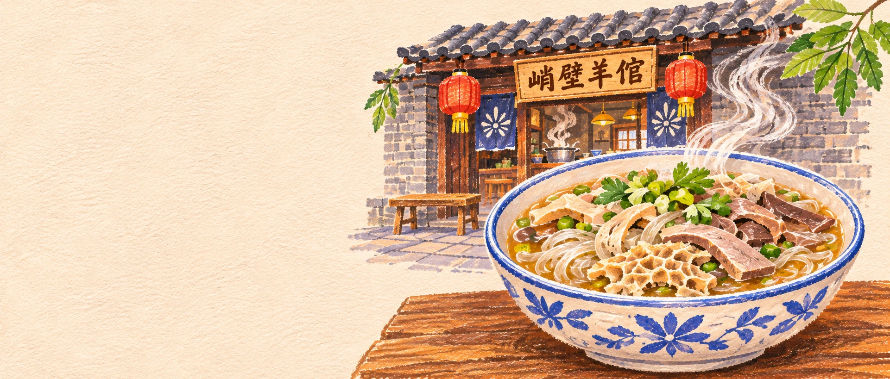

#### C3 · 人物＋结果

工具实测、视频教程、改造前后。提供人物与一个可视化结果，指定视线或手势。

> `$visual-prompt-library` 用 C3 做工具教程封面，一位开发者指向已经完成的网站，标题是「网站做好了」。

**验图重点** · 人物和结果在手机缩略图上都能读懂。

#### C5 · 一眼懂的概念图

术语解读与工作流。先提供两个概念和它们的关系，再指定媒介与标题。

> `$visual-prompt-library` 用 C5 做「一稿三用」封面，把一份草稿画成文章、视频、配图三个输出，深绿底剪纸风。

**验图重点** · 只表达一个核心关系，图形和标题可同时扫读。

#### C6 · 高密度人物封面

教程、更新、玩法合集。提供主标题、本期的具体信息和人物设定，可用卡片、截图、拼贴或胶片组织内容。

> `$visual-prompt-library` 用 C6 做「如何用 AI 工具开发网站」封面，Q 版开发者旁边用三张浏览器卡片展示梳理需求、生成页面、预览上线。

**验图重点** · 标题优先，人物醒目，鲜艳配色下仍能区分各信息块。

#### C7 · 人物＋成果展板

适合展示一套 PPT、网页或品牌稿。附 2–3 张真实成果更好，说明各自位置和人物动作。

> `$visual-prompt-library` 用 C7 做「一套咖啡品牌设计」，左侧放标题，右边画设计师把包装、菜单和海报钉到软木板上。

**验图重点** · 人物的手势引导看展板，作品属于同一套且各有侧重点。

### 账号横幅

#### C11 · 橙白棋盘欢迎横幅

16:9 横长图。用橙白棋盘格框住频道介绍，左文右人。

> `$visual-prompt-library` 用 C11 做「周末去逛逛」横幅，介绍旧书店和小市集，右侧人物指向左边，橙色飘带写「一起发现城市小角落」。

**验图重点** · 按横幅裁切预览，标题、手势和脸完整。

[查看模板规则](skills/visual-prompt-library/references/social-covers.md)

#### C12 · 牛皮纸人像工具箱横幅

16:9 横长图。牛皮纸和居中人像，两边拆排栏目名和短标签。

> `$visual-prompt-library` 用 C12 做「新手剪辑工具箱」横幅，人物居中，左右拆排标题，贴上「素材整理」「节奏卡点」「字幕排版」。

**验图重点** · 拆开的标题顺着读得通，人像避开关键笔画。

[查看模板规则](skills/visual-prompt-library/references/social-covers.md)

## 个人形象

### P1 · 职业头像

提供岗位、穿搭和神态。可附本人照片作身份参考。

> `$visual-prompt-library` 用 P1 做一张女性销售职业头像，米白西装、自然笑容、暖色背景，方形，能裁成圆形头像。

**验图重点** · 双眼清楚，发顶完整，圆形裁切有空间。

### P2 · 自然生活抓拍

指定一个场所、一个动作、一个视线落点。

> `$visual-prompt-library` 用 P2 生成花店抓拍，人物低头用牛皮纸包一束花，阴天窗光，手与花都入画。

**验图重点** · 动作、视线和手持物相互对应。

### P3 · 电影感肖像

说明情绪、光源和环境时间。可附同一人物的底图。

> `$visual-prompt-library` 用 P3 做雨夜咖啡馆肖像，蓝色窗光勾边、暖灯照亮脸，人物看向窗外。

**验图重点** · 冷暖分离清楚，眼神和脸部轮廓仍可辨认。

### P4 · 复古直闪

提供年代感、场地和穿搭。直闪、硬阴影和轻颗粒是主要风格特征。

> `$visual-prompt-library` 用 P4 把参考人物拍成咖啡店外的傍晚直闪人像，牛仔外套，卡片机质感。

**验图重点** · 闪光方向明确，肤色和面部特征稳定。

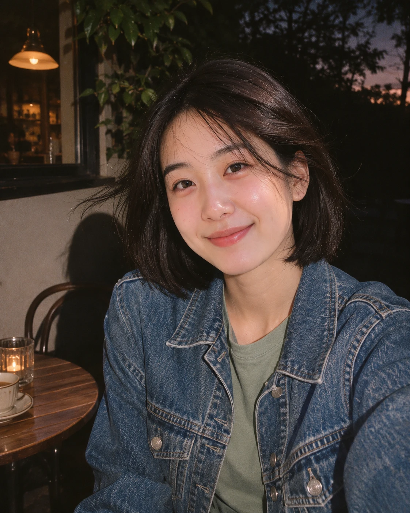

### P5 · 真人换装

分别附人脸和衣服参考，或用文字描述新造型。按需指定第三张为姿势参考。

> `$visual-prompt-library` 用 P5 保留参考图中的脸和短发，把衣服换成酒红风衣，在街边自然站立。

**验图重点** · 面部、服装结构和身体比例分别核对。

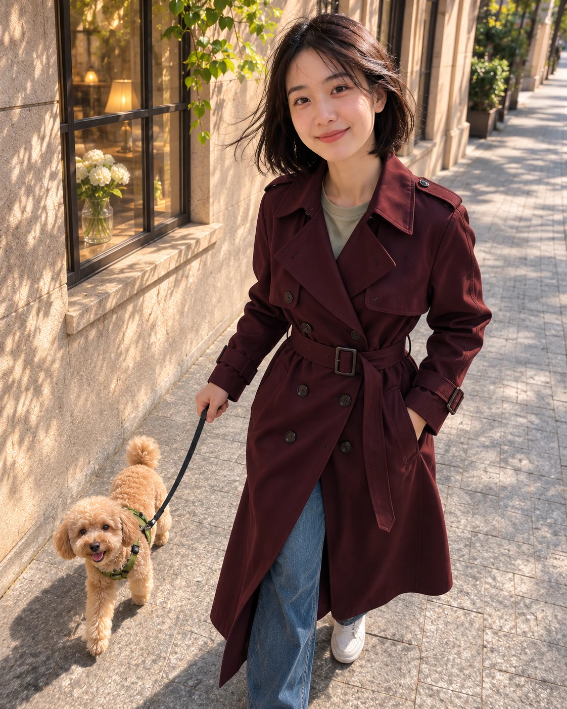

### P8 · 黄金时刻双人肖像

可提供两张人像并标明左右位置、动作与关系。

> `$visual-prompt-library` 用 P8 做一对虚构成年人的窗边近景，她靠着对方肩侧，暖阳穿过百叶。

**验图重点** · 两张脸无串位，表情和光向一致。

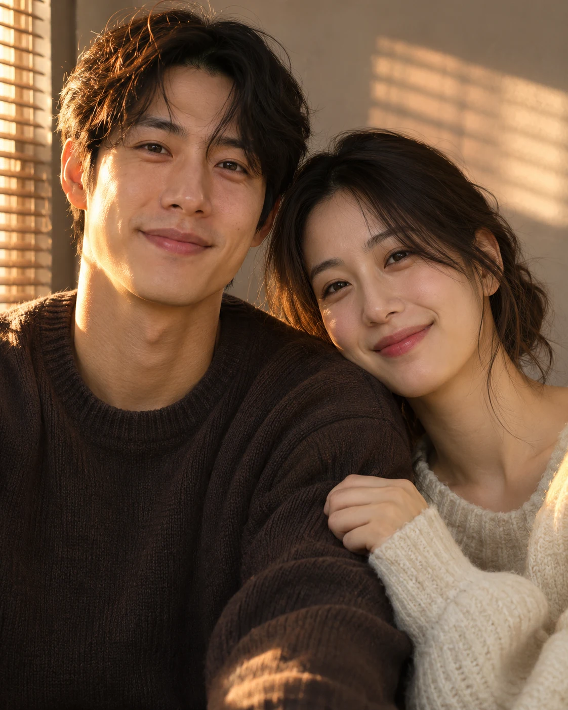

### P9 · 东京夜间镜面自拍

提供环境、穿搭和手机姿势。直闪搭配少量夜间环境光。

> `$visual-prompt-library` 用 P9 做东京夜间镜面自拍，短发、复古皮夹克，手机挡住一小部分脸。

**验图重点** · 镜中手机、握持手和人物位置合理。

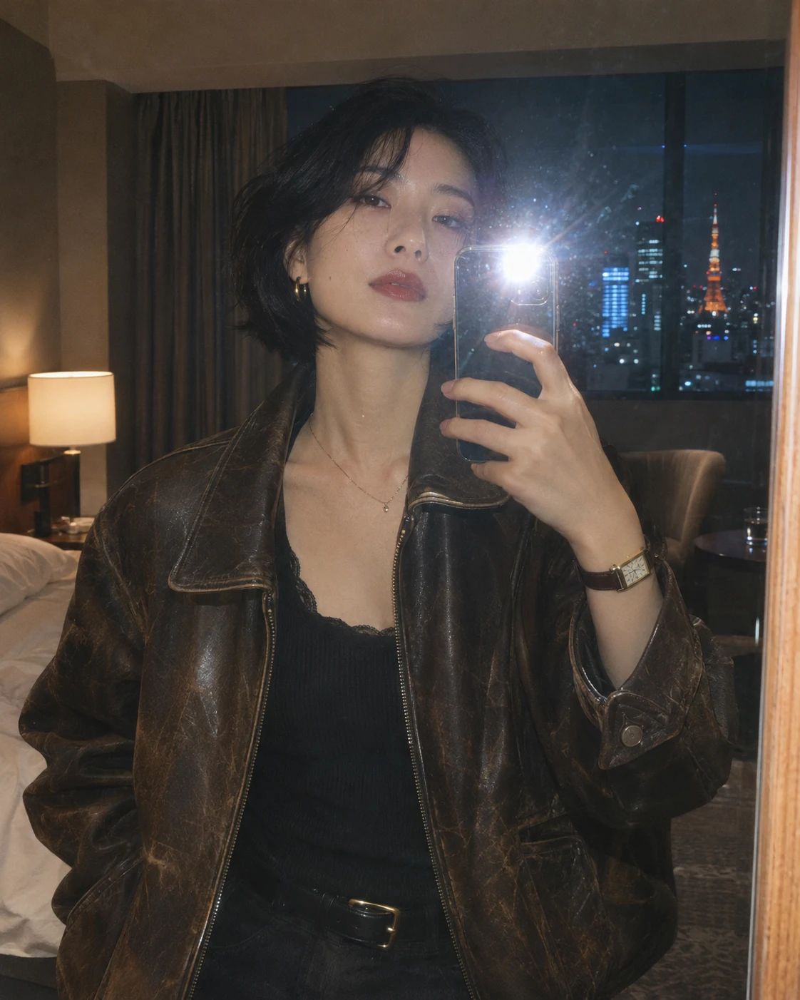

### P10 · 带狗街头抓拍

分别指定人、穿搭、宠物和牵绳动作，使用略高的手机广角视点。

> `$visual-prompt-library` 用 P10 生成午后街拍，虚构短发女生一手自拍、一手牵杏色小贵宾，9:16。

**验图重点** · 牵绳连到胸背带，宠物比例和四肢自然。

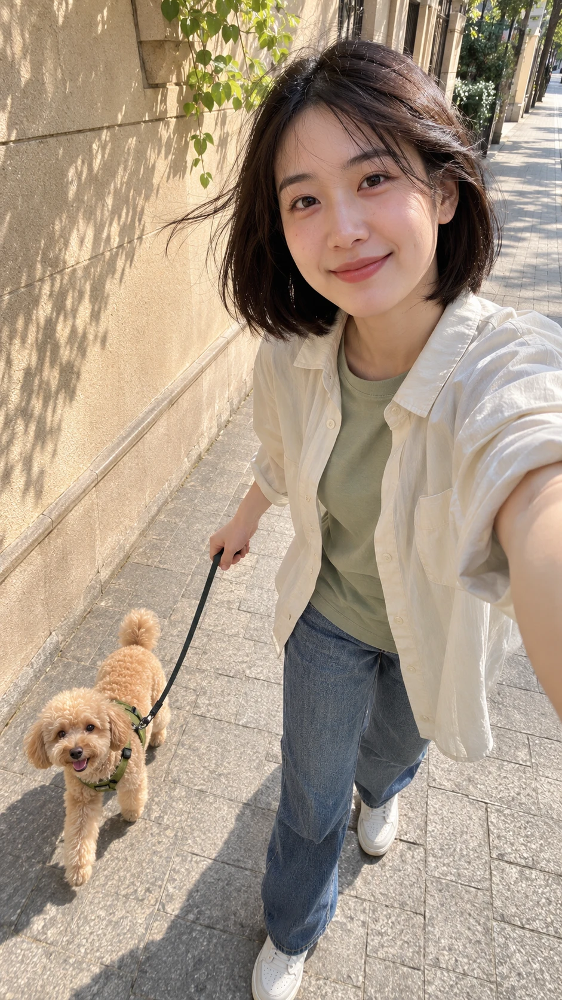

### P11 · 缎面吊带窗边人像

提供服装、回头或正面姿势、光向。可附参考脸或上一张成图锁身份。

> `$visual-prompt-library` 用 P11 做黑色缎面吊带窗边人像，侧身回头，柔和侧后窗光，9:16。

**验图重点** · 手势自然，缎面高光可读，人物脸部清楚。

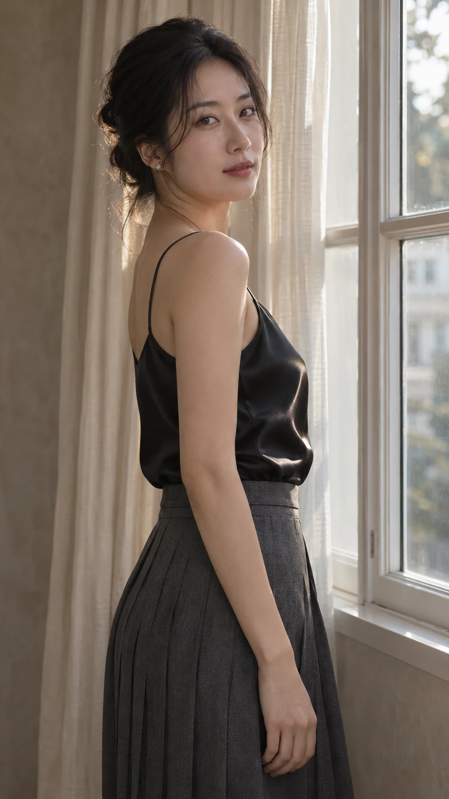

## 电商与品牌

### C4 · 物件特写

商品、书籍和工具测评。上传商品图，指定关键材质、承托面、光线和留白方向。

> `$visual-prompt-library` 用 C4 做露营灯测评封面，保留深绿灯身、弧形提手和琥珀灯罩，用侧光，左侧留标题位。

**验图重点** · 商品形状和关键材质清楚，提手完整入画。

### E1 · 电商虚拟模特试穿

图一放服装商品图，图二放模特图。可另附背面和局部细节。

> `$visual-prompt-library` 用 E1 把图一的鼠尾草绿工装外套穿到图二模特身上，锁纽扣、口袋、领口和布料颜色，保持模特原有脸型。

**验图重点** · 服装版型、遮挡、光向和垂坠与参考相符。

样例输入：[服装平铺图](examples/e1-garment.webp) · [虚构模特参考](examples/e1-model.webp)。

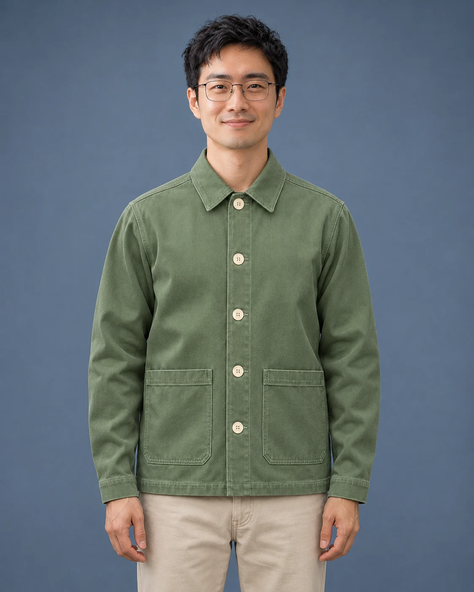

### E2 · 3D Q 版微缩品牌店

给品牌、代表产品和主色，可补充店招原文、场景和角度。

> `$visual-prompt-library` 用 E2 做「肠有脆」微缩品牌店，让开花的脆皮淀粉肠成为店面结构，暖光橱窗里有炸串摊。

**验图重点** · 门店和产品轮廓都能看出来，招牌逐字核对。

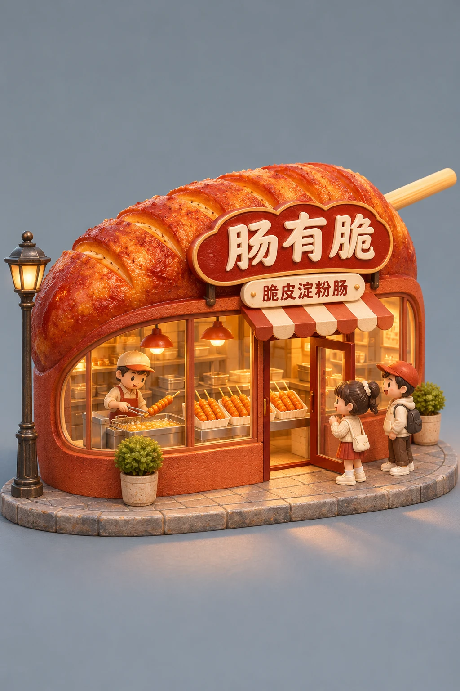

### S1 · 商品棚拍

给商品参考、机位、材质和背景，说明是否要留标题位置。

> `$visual-prompt-library` 用商品棚拍模板拍一盏森林绿露营灯，石板承托，柔光箱照出琥珀磨砂灯罩。

**验图重点** · 接触阴影合理，材质和关键零件可辨认。

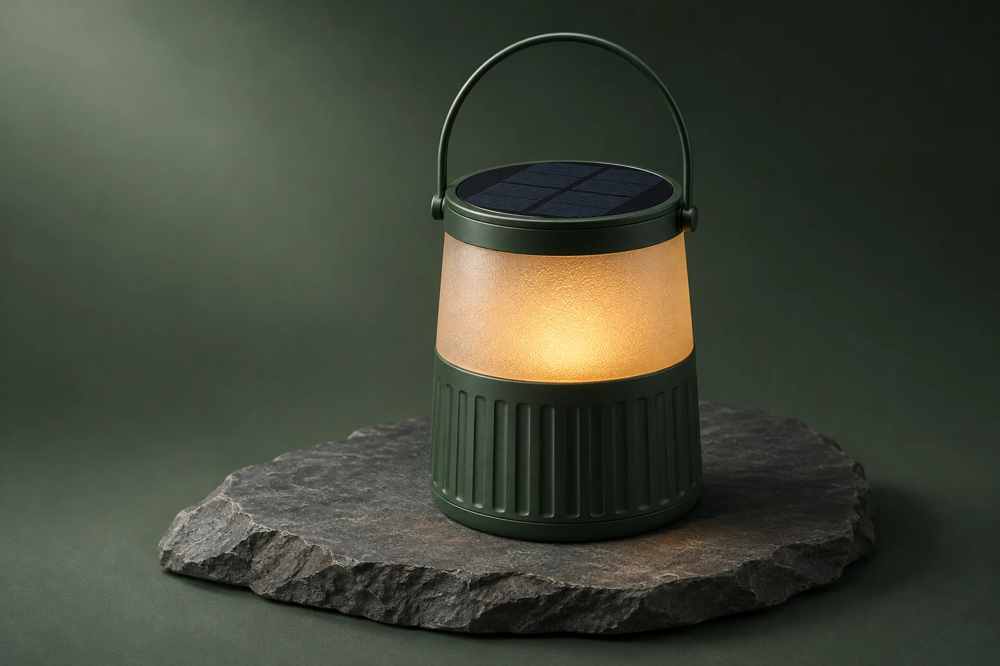

### S2 · 卖点信息图

给商品图和已核对的卖点，指定每张卡片的图形和文字。

> `$visual-prompt-library` 用卖点信息图模板做四卡 Bento，左边放露营灯，右边依次写「太阳能充电」「暖光灯罩」「便携提手」。

**验图重点** · 图文对应，文字逐字核对，避免编造规格。

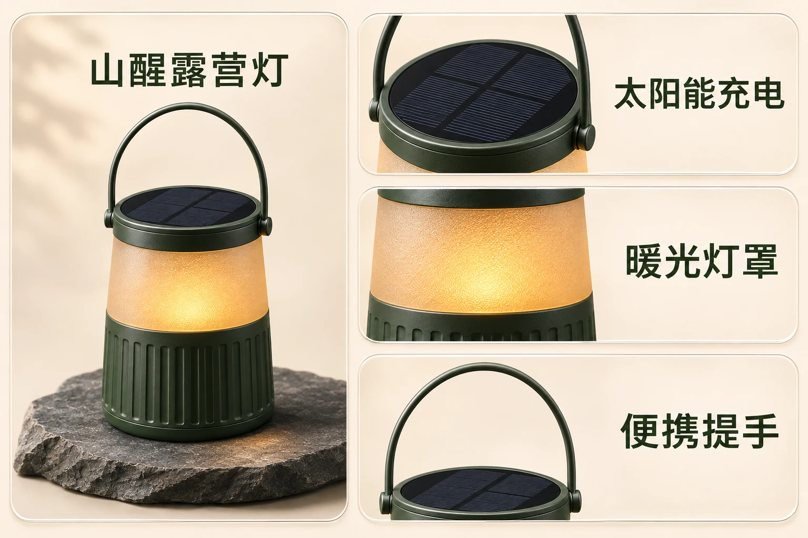

## 插画与短剧

### H1 · 彩铅手绘导览

4:5 竖版起步。两位彩铅小主持人引导读者看一整块目录展板。

> `$visual-prompt-library` 用 H1 做「新手剪辑工具箱」，给我排三组工具，右上和左下各画一位小主持人。

**验图重点** · 分组数量与条目对应，角色和对白不盖编号。

[查看模板规则](skills/visual-prompt-library/references/handdrawn-posters.md)

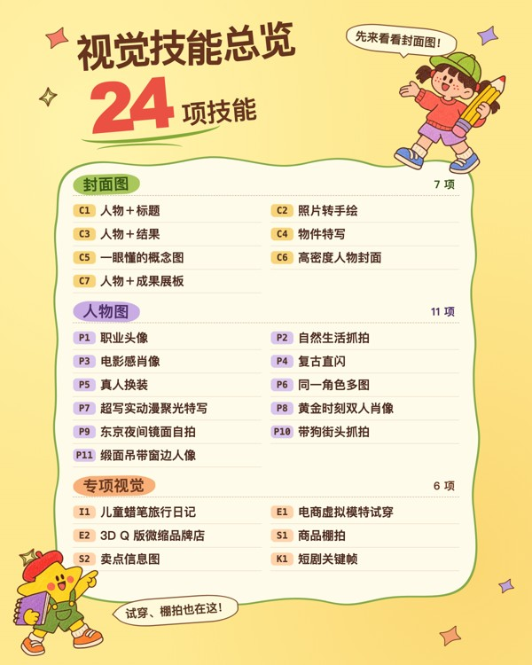

### H2 · 粗笔手写便签

3:4 竖版。粗笔手写字、橙色圈线和黄色勾选清单，适合短句海报。

> `$visual-prompt-library` 用 H2 做「学会管理时间」，圈出「时间」，左边画小狐狸拨计时器，右边放三条行动。

**验图重点** · 逐字核对标题、清单、收尾句和圈线位置。

[查看模板规则](skills/visual-prompt-library/references/handdrawn-posters.md)

### I1 · 儿童蜡笔旅行日记

提供城市、站点顺序或探店主题。真实地名、店名和行程信息先核对。

> `$visual-prompt-library` 用 I1 做《大同豆面日记》，画逛古城、进面馆、吃豆面，用红色虚线串起来。

**验图重点** · 地名、标签和叙事顺序对应。

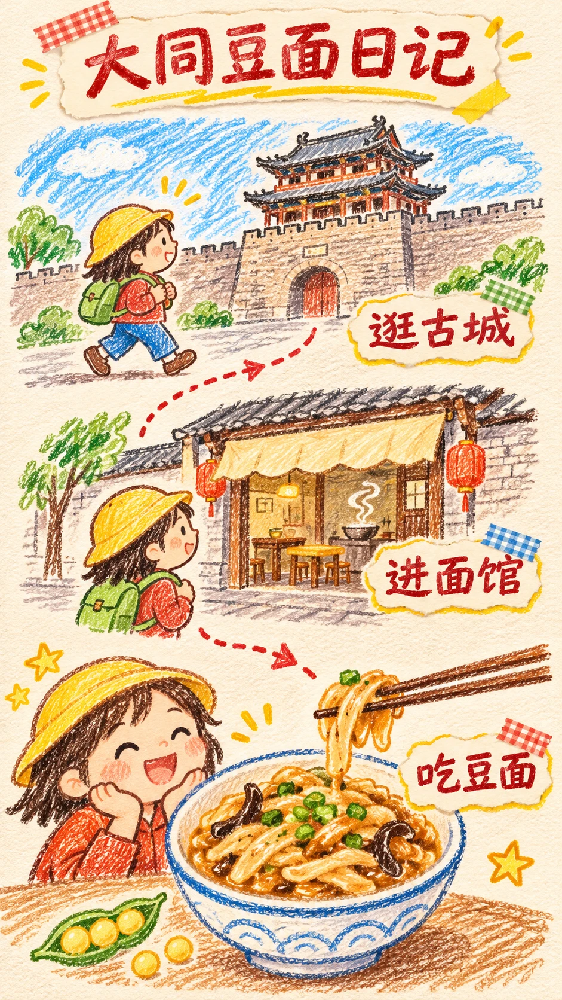

### P6 · 同一角色多图

用同一张参考图锁角色；给出每张的动作、景别和机位。样例是并排预览，需独立成图时逐张生成。

> `$visual-prompt-library` 用 P6 把同一位角色做成正面、四分之三侧面和侧脸三格，统一发型、服装与窗光。

**验图重点** · 各张的脸型、发型和辨识特征可对照。

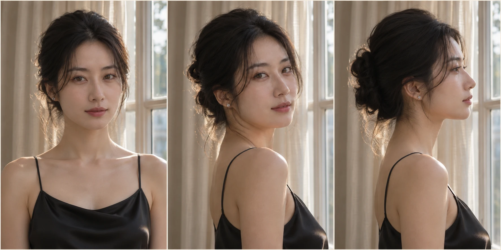

### P7 · 超写实动漫聚光特写

给角色外观和暗部范围，用窄束硬光把注意力集中在脸上。

> `$visual-prompt-library` 用 P7 做黑发动漫角色特写，黑底，窄束硬光打在脸中央，眼睛直视镜头。

**验图重点** · 亮区聚焦，暗部层次清楚，保留动漫造型。

### K1 · 短剧关键帧

指定场景中的一个动作、机位、光线和角色锚点。可附人物或场景图。

> `$visual-prompt-library` 用短剧关键帧模板做单帧：蓝调雨夜，黄雨衣骑手在车站檐下回头看亮着红尾灯的自行车。

**验图重点** · 单帧能交代动作、角色关系和场景。

## 文件结构

- [Skill 入口](skills/visual-prompt-library/SKILL.md)
- [封面模板](skills/visual-prompt-library/references/covers.md) · [社媒封面与横幅](skills/visual-prompt-library/references/social-covers.md) · [手绘海报](skills/visual-prompt-library/references/handdrawn-posters.md) · [人物模板](skills/visual-prompt-library/references/portraits.md) · [旅行与电商模板](skills/visual-prompt-library/references/specialty-visuals.md) · [通用案例索引](skills/visual-prompt-library/references/recipes.md)
- `skills/visual-prompt-library/assets/` 保存 C6、C7 构图参考和 H1、H2 的原创样图。
- `examples/` 保存生成示例的网页预览。S1、S2 和 K1 是本页的导航编号，调用时可直接说模板名称。

## 来源与使用范围

Skill 的流程和模板是针对 GPT 图片工具重新编写的。两个上游社区库的案例链接保留在各模板旁。用户提供的 C6、C7 图片用于构图参考，示例图是 AI 生成样稿。使用真实人物、品牌素材或第三方案例前，按对应素材的授权范围使用。

- [YouMind OpenLab 案例库](https://github.com/YouMind-OpenLab/awesome-nano-banana-pro-prompts) · [上游 CC BY 4.0 声明](https://github.com/YouMind-OpenLab/awesome-nano-banana-pro-prompts/blob/main/LICENSE)
- [ZeroLu 案例库](https://github.com/ZeroLu/awesome-nanobanana-pro) · [上游 MIT 声明](https://github.com/ZeroLu/awesome-nanobanana-pro/blob/main/LICENSE)
